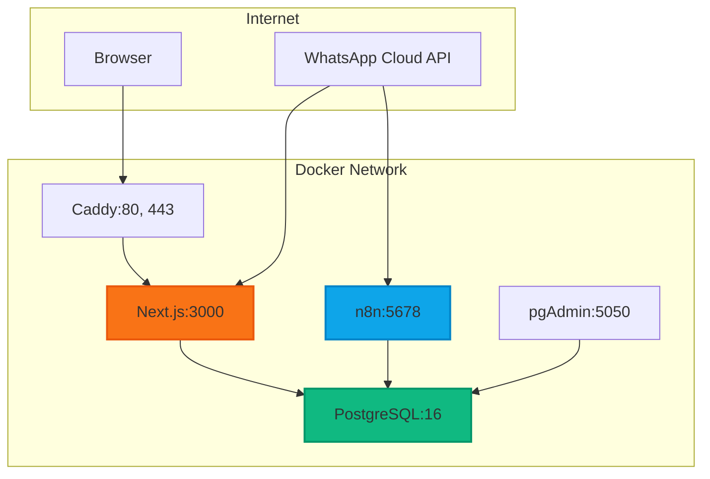

# ClinicPing

Multi-clinic SaaS for Indian clinics with WhatsApp appointment reminders, chat inbox, recalls, and cash book.

[](https://github.com/clinicping/clinic-ping/actions)
[](https://github.com/clinicping/clinic-ping/actions)

## Quick Start (Windows PowerShell)

> **Prerequisites:** Windows 11, Docker Desktop installed and running

```powershell
# 1. Clone the repository
git clone https://github.com/clinicping/clinic-ping.git
cd clinic-ping

# 2. Copy and configure environment variables
Copy-Item .env.example .env
# Edit .env with your actual values

# 3. Start all services
docker compose -f docker/docker-compose.yml up -d

# 4. Run database migrations
docker compose exec web npx drizzle-kit push:pg

# 5. Access the application
# Web: http://localhost:3000
# n8n: http://localhost:5678
# pgAdmin: http://localhost:5050
```

## Architecture Overview



## Services

| Service | Port | Description |
|---------|------|-------------|
| Web | 3000 | Next.js application |
| n8n | 5678 | Workflow automation |
| PostgreSQL | 5432 | Database |
| pgAdmin | 5050 | Database admin |
| Caddy | 80, 443 | HTTPS reverse proxy |

## Project Structure

```
clinic-ping/
├── apps/
│   └── web/                    # Next.js frontend (App Router)
│       ├── src/
│       │   ├── app/            # App Router pages
│       │   ├── components/     # shadcn/ui components
│       │   ├── lib/            # Utilities, db, auth
│       │   └── styles/         # Tailwind config
│       └── package.json
├── packages/
│   ├── db/                     # Drizzle ORM schema & migrations
│   └── ui/                     # Shared UI components
├── n8n/
│   └── workflows/              # Version-controlled workflow JSONs
├── docker/
│   ├── docker-compose.yml      # Main stack
│   └── Caddyfile               # HTTPS configuration
├── docs/
│   ├── architecture.md         # System architecture
│   └── runbook.md              # Operations guide
├── .github/
│   └── workflows/
│       ├── ci.yml              # CI pipeline
│       └── dependabot.yml      # Dependency updates
├── .env.example                # Environment template
├── package.json                # Workspace root
└── README.md
```

## Development Setup

### Local Development (without Docker)

```powershell
# Install dependencies
npm install

# Set up environment
Copy-Item .env.example .env
# Edit .env with your values

# Start database
docker run -d --name clinicping-postgres \
  -e POSTGRES_USER=clinicping \
  -e POSTGRES_PASSWORD=clinicping \
  -e POSTGRES_DB=clinicping \
  -p 5432:5432 \
  postgres:16-alpine

# Run migrations
npx drizzle-kit push:pg

# Start development server
npm run dev
```

### Available Scripts

```bash
npm run dev          # Start dev server
npm run build        # Build application
npm run test         # Run tests
npm run typecheck    # TypeScript type checking
npm run lint         # ESLint
npm run format       # Prettier formatting
```

## Environment Variables

| Variable | Required | Description |
|----------|----------|-------------|
| `DATABASE_URL` | ✅ | PostgreSQL connection string |
| `NEXTAUTH_SECRET` | ✅ | Auth secret (min 32 chars) |
| `NEXTAUTH_URL` | ✅ | App URL |
| `WA_ACCESS_TOKEN` | ⚠️ | WhatsApp Cloud API token |
| `WA_PHONE_NUMBER_ID` | ⚠️ | WhatsApp phone number ID |
| `N8N_WEBHOOK_SECRET` | ✅ | For HMAC signature verification |
| `CHATWOOT_API_BASE_URL` | ⚠️ | Chatwoot API URL |
| `CHATWOOT_ACCESS_TOKEN` | ⚠️ | Chatwoot access token |

## Data Model

### Core Entities

- **clinics** - Multi-tenancy isolation
- **users** - Authentication with roles (owner, receptionist)
- **doctors** - With weekly slots, breaks, holidays
- **patients** - Name, phone, opt-in status only (NO medical data)
- **appointments** - Doctor-patient scheduling with status tracking
- **reminders** - WhatsApp message tracking
- **cash_entries** - Inflow/outflow with paise amounts
- **message_log** - WhatsApp message history
- **audit_log** - Security audit trail

See [docs/architecture.md](./docs/architecture.md) for full schema.

## WhatsApp Integration

The system uses Meta Cloud API for WhatsApp:

1. **Outbound messages**: Sent via Chatwoot integration
2. **Inbound webhook**: Single webhook receives button replies
3. **n8n workflow**: Processes Confirm/Reschedule/STOP
4. **Database update**: Updates appointment/patient status

### WhatsApp Templates (Need Meta Approval)

- `appointment_reminder_24h` - 24h before appointment
- `appointment_reminder_2h` - 2h before appointment
- `appointment_confirm` - Confirmation message
- `recall_template` - Follow-up after visit
- `owner_monthly_report` - Monthly summary

## CI/CD

GitHub Actions pipeline runs:

1. **Lint**: ESLint for code quality
2. **Typecheck**: TypeScript validation
3. **Test**: Vitest unit tests
4. **Build**: Production build
5. **Coverage**: 80% minimum required

## Security

- Multi-tenancy via PostgreSQL Row-Level Security
- No medical data storage (India DPDP Act compliant)
- Password hashing with bcrypt
- CSRF protection
- Rate limiting on all endpoints
- Audit logging for sensitive actions

## Backup

Daily PostgreSQL dumps with restore testing:

```bash
# Manual backup
docker exec clinicping-postgres pg_dump -U clinicping clinicping > backup.sql

# Restore
docker exec -i clinicping-postgres psql -U clinicping clinicping < backup.sql
```

Set `BACKUP_SCHEDULE` in `.env` for automated backups (cron syntax).

## Testing

```bash
# Unit tests
npm run test

# Coverage report
npm run test:coverage

# E2E tests (Playwright)
npx playwright test
```

### Test Coverage
- **Target:** 80%+ minimum
- **Unit:** Business logic (slots, reminders, cash totals)
- **Integration:** API endpoints, RLS policies
- **E2E:** Critical flows (login, booking, WhatsApp)

## API Reference

See [docs/api.md](./docs/api.md) for full API documentation.

### Internal API (n8n ↔ App)

All n8n calls require HMAC-signed requests:

```
X-Timestamp: <unix_timestamp>
X-Signature: <sha256_hmac(timestamp + path + body, secret)>
```

## Docker Usage

### Start All Services

```powershell
docker compose -f docker/docker-compose.yml up -d
```

### Stop All Services

```powershell
docker compose -f docker/docker-compose.yml down
```

### View Logs

```powershell
docker compose -f docker/docker-compose.yml logs -f
```

### Rebuild & Restart

```powershell
docker compose -f docker/docker-compose.yml up -d --build
```

## Deployment

### Production Deployment (VPS)

1. **Server requirements:**
   - Ubuntu 22.04 LTS
   - Docker Engine + Docker Compose
   - Domain name (e.g., clinicping.example.com)

2. **Deploy:**
```bash
# On VPS
git clone https://github.com/clinicping/clinic-ping.git
cd clinic-ping

# Configure environment
cp .env.example .env
# Edit .env with production values

# Deploy
docker compose -f docker/docker-compose.yml -f docker/docker-compose.prod.yml up -d
```

3. **HTTPS:** Caddy automatically obtains Let's Encrypt certificates

## Support

- **Documentation:** [docs/](./docs/)
- **Issues:** [GitHub Issues](https://github.com/clinicping/clinic-ping/issues)
- **Discussions:** [GitHub Discussions](https://github.com/clinicping/clinic-ping/discussions)

## License

MIT - See [LICENSE](LICENSE) file.

## Contributing

1. Fork the repository
2. Create a feature branch
3. Make your changes
4. Run tests and ensure they pass
5. Submit a Pull Request

Please read [CONTRIBUTING.md](CONTRIBUTING.md) for development guidelines.

---

**ClinicPing** - Simple, secure clinic management for Indian doctors.