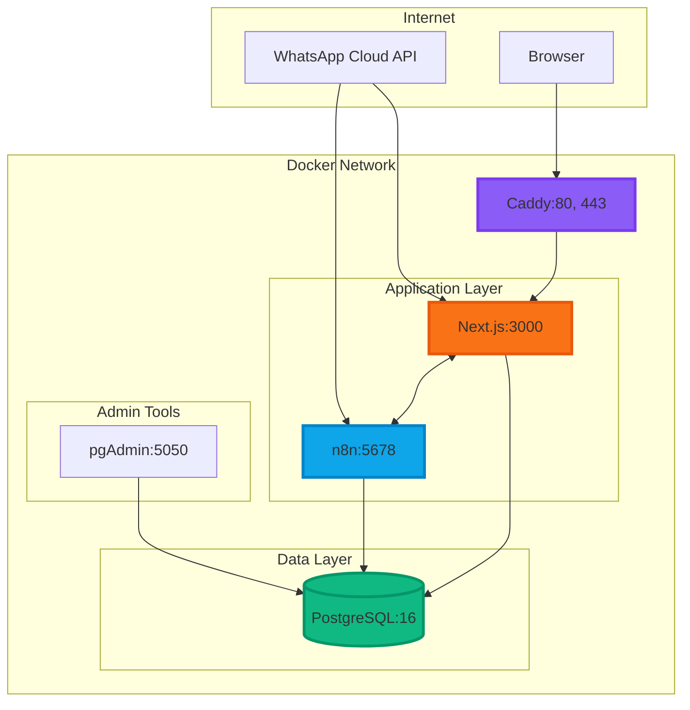
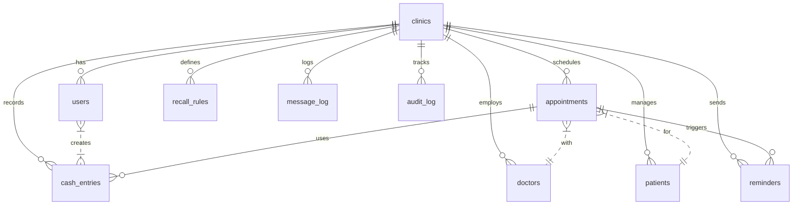
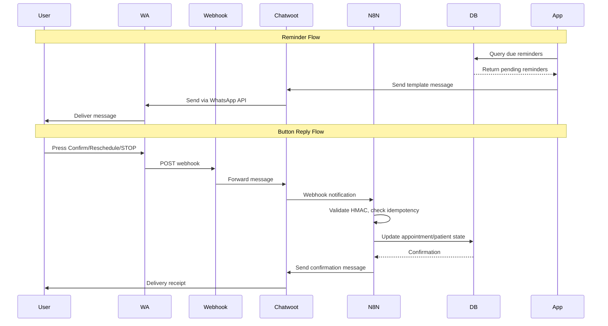
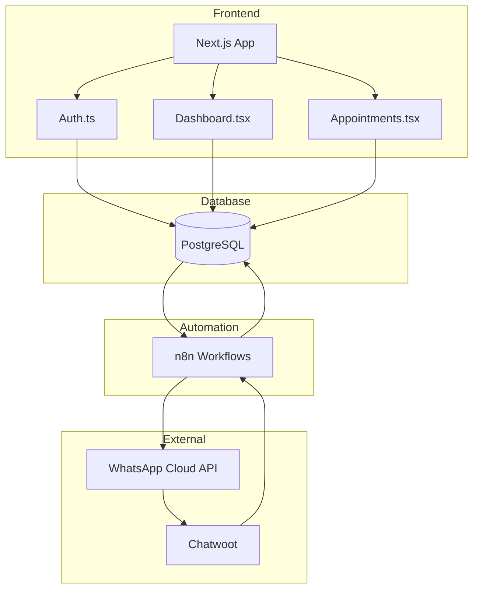
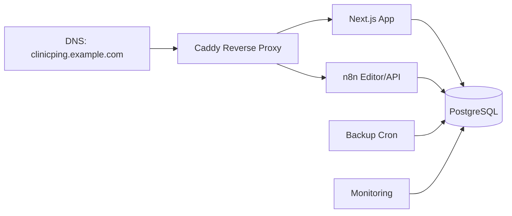

# ClinicPing Architecture

## System Architecture



## Multi-Tenancy Architecture



## WhatsApp Integration Flow



## Technology Decisions

### Why Next.js App Router?

1. **Server Components** - Reduces client bundle size
2. **Route Segments** - Better code splitting
3. **Built-in Optimization** - Automatic caching, images
4. **TypeScript First** - Strong typing throughout

### Why Drizzle ORM?

1. **Type Safety** - Full TypeScript support
2. **Schema-First** - Migrations from schema changes
3. **Lightweight** - Smaller than Prisma
4. **PostgreSQL Native** - Excellent Postgres support

### Why n8n?

1. **Visual Workflows** - Easy to understand and modify
2. **Community Nodes** - Extensive integration library
3. **Self-Hosted** - Data stays in your control
4. **JSON Export** - Version-controllable workflows

### Why Chatwoot?

1. **Open Source** - Free to use and modify
2. **WhatsApp Integration** - Official Meta integration
3. **Omnichannel** - Email, chat, WhatsApp in one
4. **Webhook System** - Flexible event handling

## Data Flow Diagram



## Security Layers

1. **Authentication** - NextAuth.js with bcrypt password hashing
2. **Authorization** - RBAC (owner, receptionist)
3. **Multi-Tenancy** - PostgreSQL Row Level Security + app checks
4. **Input Validation** - Zod schemas on all inputs
5. **Rate Limiting** - On auth endpoints and webhooks
6. **CSRF Protection** - Built-in NextAuth.js
7. **Secure Cookies** - HttpOnly, SameSite, Secure (in production)

## Deployment Architecture



### Production Deployment

1. **VPS Setup** - Ubuntu 22.04 LTS
2. **Docker Engine** - Container runtime
3. **Domain** - SSL certificate via Let's Encrypt (Caddy)
4. **Backup** - Daily pg_dump to cloud storage
5. **Monitoring** - Health checks via Caddy

## API Architecture

### REST API Endpoints

All endpoints require Bearer token or session authentication.

```typescript
// Internal API (n8n ↔ App)
// Routes: /api/internal/*
// Authentication: HMAC signature

interface InternalRequest {
  headers: {
    'X-Timestamp': string;
    'X-Signature': string;  // sha256_hmac(timestamp + path + body, secret)
  };
  body: any;
}

// Public API (frontend)
// Routes: /api/*
// Authentication: Session/JWT
```

### External API

WhatsApp Cloud API endpoints used:

- `POST /{phone-number-id}/messages` - Send messages
- `POST /{phone-number-id}/contacts` - Lookup contacts
- Webhooks - Receive message events

## Environment Requirements

| Resource | Minimum | Recommended |
|----------|---------|-------------|
| CPU | 2 cores | 4 cores |
| RAM | 4 GB | 8 GB |
| Storage | 20 GB | 50 GB SSD |
| PostgreSQL | 16.x | 16.x |
| Node.js | 20.x | 20.x |

## Scaling Considerations

1. **Read Replicas** - For reporting queries
2. **Redis Cache** - For session storage
3. **Load Balancer** - Multiple app instances
4. **Message Queue** - Kafka/RabbitMQ for high volume
5. **CDN** - Static assets, images